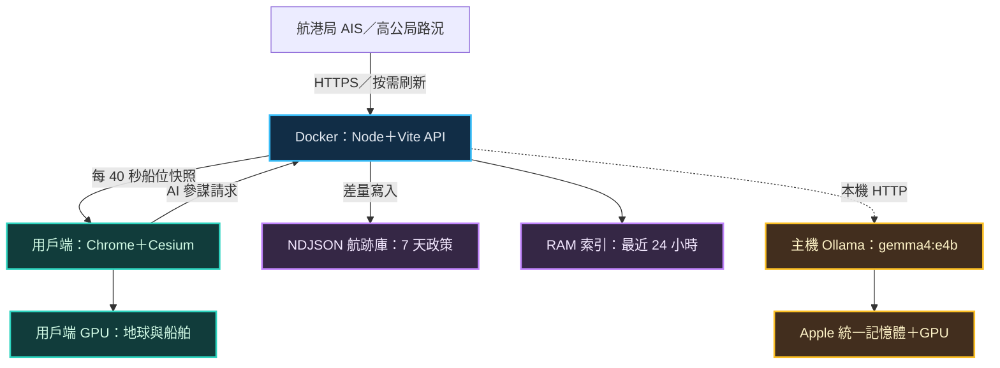
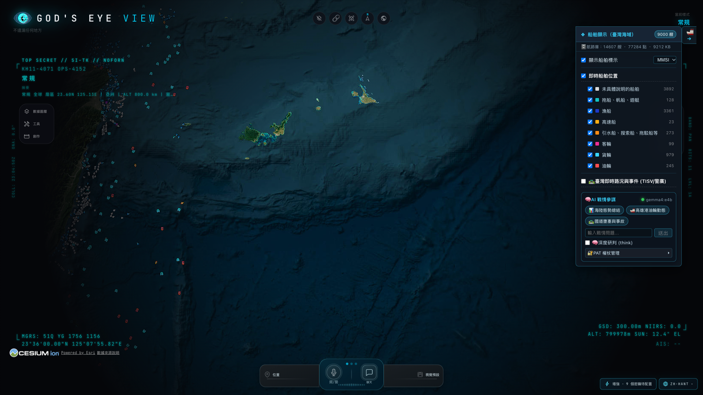

# 上帝之眼（God's Eye View）全系統當前資源耗用實測與跨裝置移植硬體規格評估報告

> 量測日期：2026-11-05（Asia/Taipei，UTC+8）。這次量的是專案目前的 Docker／Vite 開發部署、臺灣 AIS 船舶與路況子系統，還有裝在主機上的原生 Ollama。文中「實測」「推估」「建議驗收目標」都會分開標，不會混在一起。MB／GB 用十進位，MiB／GiB 用二進位；買記憶體時看的規格，則照廠商慣用的 GB 寫法。

## 01｜部署結論與決策摘要

**如果你想在同一台電腦上，一邊跑近萬艘船的 3D 戰情台、一邊跑本機 AI，記憶體建議直接從 32 GB 起跳。** 手上這台 Apple M4／16 GB 當然跑得動，不過同一天 AI 測試前後，系統 swap 從 4,833.94 MiB 漲到 10,411.38 MiB。「能開起來」跟「能整天穩穩值勤」是兩回事。要提醒的是，這是整台主機的觀察，裡面也有別的應用程式在吃資源，不能把增加的量全算在本系統頭上。

| 核心指標 | 實測數值 | 部署上的意義 |
| --- | --- | --- |
| 磁碟｜應用映像 | 1.54 GB；內容大小 433 MB | 另計原始碼、Docker volume、建置快取與 AI 模型 |
| RAM｜本機 AI 載入 | 9.42 GB，約 8.77 GiB | Apple 統一記憶體由 CPU／GPU 共用，不要重複加總 |
| CPU｜容器當前快照 | 2.80%；983.7 MiB／7.748 GiB | CPU 100% 約相當一個邏輯核心；此值不是整台主機負載 |
| GPU｜近萬艘船旋轉 | 41.40 FPS；43.22 次 Draw Calls／幀 | 同日主量測為 9,976 艘、1920×1080、Metal 硬體繪圖 |

先抓個大方向：**最低 MVP** 用 8～16 GB、4 核心、支援 WebGL2 的內顯就能把資料和地圖跑起來，但同一台機器上別再開大型 AI。**Standard** 抓 32 GB、8 核心以上，GPU 要留點餘裕。**24/7 指揮中心** 則是 64 GB 以上，推論資源獨立出去，再配 SSD 和備份；就算主機再大，值勤與故障復原還是得另外設計。

### 🚀 跨裝置移植三級硬體規格對比速查卡片 (Hardware Specs Fast Reference)

| 規格項目 | 🟢 最低 MVP | 🔵 推薦 Standard | 🟣 旗艦 Command Center |
| --- | --- | --- | --- |
| CPU | 現代 4 核心 | 8 核心以上（如 Core i7／Ryzen 7） | 12～24 核心 |
| RAM | 8～16 GB | **32 GB** | 64～128 GB |
| GPU／VRAM | 硬體 WebGL2 整合 GPU；AI 遠端或關閉 | 獨顯 16 GB VRAM 起評估（如 RTX 4060 Ti 16GB），或 Apple 32 GB 統一記憶體 | VRAM 24～48 GB 起；顯示與推論分機 |
| SSD | 128 GB（可用 ≥40 GiB） | 512 GB～1 TB NVMe（可用 ≥65 GiB） | 1 TB 以上 NVMe＋備份另碟 |
| 網路頻寬 | 下行 10 Mbps 以上 | 下行 50 Mbps 以上 | 100～300 Mbps 以上；有線＋備援 |

這些都是從單機 M4 的實測往外推的採購起點，不是每種配置都真的測過；x86 平台的細節請看 [第 09 章 x86 專題](#hardware)，想直接動手安裝的話，跳到[第 11 章](#handson)。

## 02｜量測邊界、方法與環境

| 項目 | 本次環境與取樣方式 |
| --- | --- |
| 主機 | MacBook Pro（Mac16,1）；Apple M4，10 核心 CPU、10 核心 GPU、16 GiB 統一記憶體 |
| 作業系統 | macOS 27.2；Darwin arm64 |
| Docker | Desktop 4.98.0；Engine 29.9.2；Linux arm64 映像；VM 可用 10 CPU、7.748 GiB RAM |
| 部署型態 | `repo/compose.yaml`；Node＋Vite 開發伺服器與 API 同容器，原始碼 bind mount；主機 Ollama 經 `host.docker.internal:11434` 連接 |
| 瀏覽器 | Playwright 控制獨立 Chrome 156.0.8078.81，前景、有視窗、1920×1080、DPR 1、resolutionScale 1 |
| GPU 驗證 | `ANGLE Metal Renderer: Apple M4`；未使用 SwiftShader；瀏覽器的 GPU 工作在用戶端，並非 Node 容器內 |
| 場景 | 3D 地球、臺灣船舶；動態測試每個動畫回呼旋轉相機 0.00012 rad；各情境觀察 15 秒 |
| 首輪資料 | 06:58 起的主機快照；約 07:02～07:09 的瀏覽器與 AI 量測，保留原始 JSON |
| 接續複核 | 07:44 的磁碟／容器／模型快照；另留當前瀏覽器複測與獨立 HTTP 快取測試 |

FPS 以 Cesium `scene.postRender` 的實際繪製幀數除以觀察時間計算；`requestAnimationFrame` 的回呼頻率另列，兩者不可混用。Draw Calls 由 WebGL／WebGL2 的 draw 方法計數，含地球、底圖與其他繪製工作。DOM 同時記錄 `querySelectorAll('*')` 元素數與 CDP 節點數。

先講清楚這份量測的限制：只有單一主機、短時間的樣本，沒有做 24 小時連續測試、多用戶壓力測試、4K 多螢幕、全部圖層同開、CCTV 多路解碼，也沒測多模態 AI 推論。容器遙測每輪要跑好幾個指令，大約 2～3 秒才拿到一筆，並不是精準的每秒取樣，取樣本身也會吃一點資源。另外，桌面上其他正在跑的程式和系統繪圖工作，都會影響 GPU 和 swap 的數字。

資料來源：[host.json](docs/resource-evaluation/2026-11-05/host.json)、[browser.json](docs/resource-evaluation/2026-11-05/browser.json)、[current-check.json](docs/resource-evaluation/2026-11-05/current-check.json)。

## 03｜資源分佈與架構邊界

這張圖看的是「重擔到底壓在誰身上」，幫你判斷錢該花在伺服器、顯示端，還是 AI 主機。



這是目前單機部署的資源分界，Ollama 這條線是選配。如果用遠端瀏覽器，3D 繪圖的 GPU 負擔就跑到遠端那台裝置上；所以光是把 Node 伺服器升級，手機畫面不會因此變順。還有，主機 GPU 的整體使用率，也不能直接當成某一支程式的用量。

從原始碼看，航跡檔保留 7 天，RAM 索引只留最近 24 小時，每艘船最多 360 點；要查更長的時段就得掃檔案。單船回傳最多會抽稀到 2,000 點。這樣常駐索引的大小是壓得住的，但 7 天資料累積之後查詢會慢多少，還得另外量。另外，資料更新和記錄是「有人來要才做」，如果沒有開著的用戶端或排程採集器，就別假設航跡會一直在收。

原始碼依據：[taiwan-tracks.js](server/providers/vessels/taiwan-tracks.js)、[mpb-taiwan.js](server/providers/vessels/mpb-taiwan.js)、[taiwanManager.js](src/layers/taiwanVessels/taiwanManager.js)。

## 04｜磁碟空間：把應用、歷史與模型分開算

07:44 的 `du -sk` 量到的是「已配置空間」，這張快照是在新增本報告和驗證截圖之前拍的。表裡的目錄有包含關係，每一列別直接加起來。

| 儲存對象 | 實測大小 | 判讀 |
| --- | --- | --- |
| 專案根目錄 | 935,864 KiB＝913.93 MiB | 已包含 `repo/`、既有報告、圖片與備份 |
| `repo/` | 840,600 KiB＝820.90 MiB | 已包含本機依賴、Git 與 `.gev-cache` |
| `repo/node_modules/` | 466,068 KiB＝455.14 MiB | 主機依賴；容器另有 Linux 版匿名 volume |
| `repo/.git/` | 188,184 KiB＝183.77 MiB | Git 歷史，不是執行期 RAM |
| 原始工作樹 | 邏輯 154,821,722 B＝147.65 MiB；配置 153.80 MiB | 06:58 掃描；排除依賴、Git、執行快取、量測成果 |
| `repo/.gev-cache/` | 22,544 KiB＝22.02 MiB | 包含航跡、地形高度與衛星等快取；根目錄沒有獨立 `.gev-cache/` |
| 航跡檔目錄 | 配置 11,652 KiB＝11.38 MiB；邏輯 11.04 MiB | 只有 2 個日期檔，尚未累積完整 7 天 |
| Docker 應用映像 | 1,540,974,114 B，約 1.54 GB／1.44 GiB | `docker images` 內容大小另列 433 MB，兩個數字不可相加 |
| Docker 全域環境 | volumes 4.979 GB，其中 4.526 GB 可回收；build cache 1.744 GB | 共有 11 個 volume，不能全算本系統必要容量；此次未清除 |
| 單一 AI 模型 | 邏輯 9,461,576,343 B＝9.46 GB／8.81 GiB；配置約 8.82 GiB | 同 digest 別名共用 blob，不可重算成兩份模型 |
| 全部本機 Ollama 模型 | `du -sh` 約 46 GiB | 個人其他模型也在其中；不是移植本專案必帶的容量 |

### 航跡庫實際資料與每日外推

| 檔案 | 邏輯大小 | 點數 | 檔內最早～最晚定位時間（臺灣時間） |
| --- | --- | --- | --- |
| `2026-11-04.ndjson` | 3,445,282 B＝3.29 MiB | 28,126 | 11/04 21:44:45～22:22:13 |
| `2026-11-05.ndjson` | 8,130,606 B＝7.75 MiB | 66,772 | 11/05 00:45:55～07:41:05 |
| 合計 | 11,575,888 B＝11.04 MiB | 94,898 | 首尾約 9.94 小時，期間有收集空窗 |

API 摘要當時顯示 15,378 個歷史 MMSI、94,898 點、2 個檔案、`retentionDays=7`、損壞行 0。**注意，歷史 MMSI 去重後的數字，不等於現在海上有幾艘船。** `diskKB=11,305` 是摘要依檔案長度換算出來的，跟檔案系統實際配置的空間不是同一回事；而且檔案還在寫入，依序讀取時多少會有一點時間差。

平均每行約 **121.98 B，外推時取 122 B／點**。下面這幾個數字都是容量推估，不是實測：

- **全時段平均外推**：11.04 MiB ÷ 9.94 小時 × 24 ≈ **26.66 MiB／日**；7 天約 **186.61 MiB**。期間有空窗，可能低估連續執行量。
- **短期增量外推**：06:58 摘要約 8.285 MiB，07:44 約 11.040 MiB；約 46 分鐘的增量換算為 **86 MiB／日**，7 天約 **602 MiB**。此時包含驗證請求與較頻繁的實際更新，不是長期平均。
- **時間門檻情境**：假設 10,000 艘全為航行船，全部每 10 分鐘留 1 點，`10,000 × 144 × 122` ≈ **167.54 MiB／日**；7 天約 **1.15 GiB**。這不是上限，因為位移達 30 m 也會記錄。
- **高變動規劃情境**：假設 10,000 艘每 40 秒都有新定位，且每次都通過差量門檻，`10,000 × 2,160 × 122` ≈ **2.45 GiB／日**；7 天約 **17.18 GiB**。以日檔清理時最多可能跨 8 個日檔，約 **19.63 GiB**；加 25% 餘裕約 **24.54 GiB**，建議另留 **30 GiB 航跡空間**。這是以 122 B／點及固定船數假設的規劃值，並非資料格式的絕對上限。

差量規則是這樣：航行中的船，位移至少 30 m **或**間隔至少 10 分鐘才記一點；低於 0.5 節的停泊／慢船，則要 150 m **或**30 分鐘。重複或時間倒退的定位會直接略過。清理的判斷是「日期小於 7 天前」，所以磁碟上其實可能留著 8 個日期的檔案，「7 天」不代表剛好只有 168 小時的資料。

要搬家的話，建議先預留 **應用與建置 10 GiB＋單一 AI 模型與更新餘裕 20 GiB＋航跡 30 GiB＋瀏覽器與日誌 5 GiB＝65 GiB 可用空間**，作業系統、swap 和備份另外算。這是偏保守的作業預算，不是現在的實際佔用；如果 MVP 不帶 AI，模型那一塊可以省下來。參考資料：[current-check.json](docs/resource-evaluation/2026-11-05/current-check.json)、[host.json](docs/resource-evaluation/2026-11-05/host.json)。

## 05｜Docker 容器：CPU、RAM、網路與磁碟 I/O

| 觀察情境 | CPU（Docker %） | 記憶體 | 樣本／備註 |
| --- | --- | --- | --- |
| 07:44 當前快照 | 2.80% | 983.7 MiB／7.748 GiB，12.40% | 一次快照，不代表全天平均 |
| 9,000 艘、靜止 | 平均 25.08%；20.29～32.66% | 平均 956.96 MiB | 15 秒、7 筆，含遙測開銷 |
| 9,000 艘、旋轉 | 平均 41.97%；22.63～118.41% | 平均 957.67 MiB | 15 秒、7 筆；旋轉本身在瀏覽器執行 |
| 9,000 艘＋路況、靜止 | 平均 22.50%；19.85～24.77% | 平均 961.66 MiB | 27 筆事件、453 路段；7 筆 |
| AI 首次請求期間 | 平均 35.01%；15.18～109.97% | 平均 962.09 MiB | 16 筆；模型推論在主機，不在此容器 |

這次 Compose 沒有幫容器另外設 `memory` 或 CPU 配額：`Memory=0`、`NanoCpus=0`。畫面上的 **7.748 GiB 是 Docker Linux VM 的可用上限**，不是這個容器一開始就吃掉 7.748 GiB，主機也沒有另外多出一份同樣大小的 RAM。Docker CPU 100% 大約等於用掉一個邏輯核心，118% 就是約 1.18 核心。

07:44 的 `docker top` 行程 RSS 合計為 `(603,464＋301,796) KiB`，約 **884.04 MiB**。同一時間 cgroup 的 `memory.current` 約 **1,060.07 MiB**、匿名記憶體 `anon` 約 **819.61 MiB**。Docker stats 的工作集會扣掉一部分檔案快取，RSS 加總又可能把共享頁重複算，所以這三個數字量的根本不是同一件事；別把 `docker stats` 的 983.7 MiB 當成精確的 RSS。[Docker stats 官方定義](https://docs.docker.com/reference/cli/docker/container/stats/)

同一張快照裡，**網路 I/O 是接收 244 MB／傳送 705 MB**，**Block I/O 是讀取 111 MB／寫入 49.4 MB**。這些都是容器啟動以來的累積量，不是每秒速率，也不包含主機 Ollama 讀模型、瀏覽器快取或主機 swap；bind mount 的寫入算在誰頭上，還會受 Docker Desktop 的 I/O 路徑影響。主量測時有一段約 55 秒的 AI 首次請求，網路計數大約多了接收 9 MB／傳送 8 MB，但那段時間還混著其他請求，別當成 AI API 自己的流量。

伺服器 RAM 可以先抓 **2 GiB 當服務預算、Docker VM 先給 4 GiB 起測**，再留一些給建置和突發狀況；這只是驗收的起點，並沒有真的套用資源限制。還有，這個環境跑的是 Vite 開發模式，上面的耗用不能直接當成正式打包後的結果。資料：[distributions.json](docs/resource-evaluation/2026-11-05/distributions.json)、[container-processes.txt](docs/resource-evaluation/2026-11-05/container-processes.txt)。

## 06｜本機 Ollama：模型規格與推論成本

### 模型身分與載入記憶體

| 項目 | 本機實測 |
| --- | --- |
| 模型名稱／digest 前綴 | `gemma4:e4b`／`5a08735df03c`；同 digest 別名 `gemma4:e4b-mlx` |
| 格式與後端 | safetensors；`runner=mlx`；`quantization_level=nvfp4`（以 `/api/show` 為準） |
| 參數數量 | `/api/show` 為 8.1B，`general.parameter_count=8,074,934,862`；42 layers、embedding 2560 |
| 模型與執行期 context | metadata 上限 131,072；本次實際載入 context 4,096。沒有測試 128K 記憶體需求 |
| 模型下載／檔案 | 9.46 GB（8.81 GiB） |
| 推論後載入大小 | `/api/ps` 的 `size`／`size_vram` 約 9.404～9.421 GB；約 8.76～8.77 GiB |
| CLI 狀態 | `ollama ps` 為 `100% GPU`，表示模型 GPU 放置狀態，不代表 GPU 一直滿載 |
| 版本 | server 0.40.14、CLI 0.40.13；有小版差異，移植時應記錄並對齊版本 |
| 07:44 複核 | `/api/ps` 為空陣列；當時模型已卸載，前述大小是推論期間觀察 |

E4B 名字裡的 E 是 effective 的意思；Google 官方模型卡寫的是約 4.5B effective、算上 embedding 約 8B。精確的參數數量，以本機實際檔案的 metadata 為準。**千萬別用「4B×4 bit」硬推出這個多模態 MLX 模型只有 2 GB。** NVFP4 只是量化的標示，並不表示所有張量、編碼器、執行期緩衝和 KV cache 都用同樣的位元數存。[Gemma 4 官方模型卡](https://ai.google.dev/gemma/docs/core/model_card_4)

Apple M4 是統一記憶體；`size_vram` 是後端回報的 GPU 配置／模型載入估值，跟系統 RAM 共用同一塊實體記憶體，所以不能 RAM 加一次、VRAM 再加一次 9.42 GB。它也不是獨立量到的 GPU 常駐實體頁數。換到 NVIDIA／AMD 獨立顯卡時，主機 RAM 和 VRAM 才是兩個各自獨立的容量池；模型格式、後端或量化一變，都要重新量。[Ollama 執行中模型 API](https://docs.ollama.com/api/ps)

### 有界文字推論實測

測試時頁面維持開著 9,000 艘船舶＋路況，相機不動。直接呼叫 Ollama `/api/chat`，兩次都用同一段 61-token 的提示，參數是 `think=false`、`temperature=0`、`num_predict=256`、非串流；兩次都輸出 256 tokens、`done_reason=length`，也就是被截斷的效能樣本，回答內容好不好沒有評。

| 指標 | 首次請求（模型先前未載入） | 緊接重複提示（暖機＋提示快取） |
| --- | --- | --- |
| 用戶端端到端時間 | 54.546 秒 | 7.449 秒 |
| API total duration | 54.515 秒 | 7.429 秒 |
| 模型載入時間 | 12.949 秒 | 0.026 秒 |
| Prompt evaluation | 33.092 秒；0 cached tokens | 0.0025 秒；60 cached tokens |
| 生成時間／吞吐 | 8.469 秒／30.23 tokens/s | 7.382 秒／34.68 tokens/s |
| 主機全域 GPU 利用率 | 平均 53%，42～96%，16 筆 | 平均 80%，48～96%，3 筆 |
| Ollama 行程 CPU 觀察值 | 平均 20.83%，最高 49.7% | 平均 28.97%，最高 54.8% |

CPU 的數字是從 `ps %cpu` 的行程觀察值加總來的，不是整台主機的 CPU 百分比，也不是精準的每秒增量。GPU 數字來自 `ioreg`，桌面和其他程式也算在裡面；暖機那邊只有 3 筆樣本，推不出可靠的長期負載。**7.449 秒是命中提示快取的結果，不代表隨便問個新問題都能在 7.5 秒內回你。** 這次是非串流測試，所以也沒量到首 token 延遲（TTFT）。

同一天 AI 測試前後，swap 從 4,833.94 MiB 漲到 10,411.38 MiB，多了約 **5.45 GiB**；07:44 的快照 swap 還用著 9,066.38 MiB，但那時模型已經卸載了。swap 會留著舊頁面，不能直接當成「現在差多少 RAM」。不過它至少說明了：現在這個多工環境的餘裕不夠，要升級硬體或把負載分開，這是個站得住腳的理由。

### 單機 RAM 預算（推估）

拿同一台 Apple 統一記憶體的機器來算：作業系統與一般桌面 4～6 GiB＋Docker VM 工作集及餘裕 2～4 GiB（含 Node 容器）＋瀏覽器／圖形 1～2 GiB＋AI 載入 8.77 GiB＋安全餘裕 3～5 GiB，加起來約 **19～26 GiB**。所以獨立單機從 32 GB 起跳比較合理；24 GB 也不是不行，但得管好背景程式、context 長度和同時進行的工作數。瀏覽器那 1～2 GiB 是預算值，不是這次量到的整體 RSS。

原始證據：[ollama.json](docs/resource-evaluation/2026-11-05/ollama.json)、[host.json](docs/resource-evaluation/2026-11-05/host.json)。

## 07｜Cesium：近萬艘船舶的實際繪圖負擔

### 同日主量測

| 情境（15 秒） | 船舶數 | 實際 FPS | Draw Calls／幀（平均／P95） | `performance.memory` 使用量 |
| --- | --- | --- | --- | --- |
| 即時船舶、靜止 | 9,976 | 1.00 | 29.00／29 | 173.49 MB（165.45 MiB） |
| 即時船舶、旋轉 | 9,976 | 41.40 | 43.22／45 | 179.87 MB（171.54 MiB） |
| 同頁暖機後暫移除船舶、旋轉 | 0 | 42.00 | 42.29／44 | 167.31 MB（159.56 MiB） |
| 固定真實快照、靜止 | 9,000 | 0.00 | 無繪製，不定義每幀值 | 176.29 MB（168.13 MiB） |
| 固定真實快照、旋轉 | 9,000 | 39.33 | 43.29／45 | 181.17 MB（172.78 MiB） |
| 固定快照＋路況、靜止 | 9,000 | 1.00 | 47.00／47 | 178.82 MB（170.53 MiB） |

9,000 艘的測試是從當天真實的 AIS 快照截出來的，沒有複製船隻灌水；測試期間也暫停該頁的輪詢，讓樣本固定。0 艘那一列仍保留同一頁的其他配置和快取，所以不能當成全新空白地球的乾淨基準；不過也看得出來，這個視角下地球／底圖本身就占了大部分的 Draw Calls。兩種船數不是同時、同樣熱狀態下做的嚴格對照實驗，別因此推論 9,976 艘一定比 9,000 艘更快。

**閒置時只有約 0～1 FPS，是按需繪製的省電設計，不是卡頓。** `requestRenderMode=true` 的時候，相機和資料都沒動，就不用畫新的一幀。9,976 艘旋轉時，每幀間隔 P50 約 24.1 ms、P95 約 28.1 ms。「約 41～42 FPS」只是這個特定場景的觀察，不是所有 9,000～10,000 艘情境的保證；固定 9,000 艘也實際量到 39.33 FPS。

### Heap、DOM 與計數定義

- 主頁一般元素數為 **2,605**；加路況後 **2,617**。這對應「約 2,600 個元素」，不等於 CDP 的全部節點數。
- CDP `Memory.getDOMCounters` 在 9,000 艘旋轉樣本為 **7,347 nodes、8 documents**，9,976 艘旋轉為 7,413 nodes。包括文字、文件及其他 DOM 節點，和元素選取器口徑不同。
- 「JS Heap 約 181 MB」來自 `performance.memory.usedJSHeapSize=181,170,573 B`。同樣本 CDP V8 `usedSize` 約 **104.05 MiB**，`backingStorageSize` 約 **68.76 MiB**，兩者量級可解釋 API 口徑差異，但不宣稱所有情境都能精確相加相等。
- 上述 Heap **不包含整個 Chrome 的 renderer／GPU process RSS、WebGL texture／framebuffer 與所有原生配置**，因此不能直接拿 181 MB 當成瀏覽器完整 RAM 需求。
- 船舶資料筆數、`billboard.show=true` 數量與當下真正可見的船舶像素數不同；仍有視錐、地球遮蔽與視距抽稀。這是近萬筆在席資料的測試，不是近萬艘同時出現在畫面上的保證。
- 船舶 Texture Atlas 有助合批，但整個場景約 43～45 次 Draw Calls／幀；此次沒有獨立標記船舶 pass，不能把全場景寫成 1 Draw Call，也不能宣稱已實證船舶層固定只用 1 次。

### 接續複測

| 接續情境 | 船舶數 | 實際 FPS | 平均／P95 Draw Calls | Heap（MB） |
| --- | --- | --- | --- | --- |
| 即時船舶、靜止 | 9,911 | 1.07 | 45.00／45 | 176.84 |
| 即時船舶、旋轉 | 9,911 | 48.20 | 43.13／45 | 178.70 |
| 固定快照、靜止 | 9,000 | 1.00 | 45.00／45 | 176.95 |
| 固定快照、旋轉 | 9,000 | 48.47 | 43.07／45 | 176.16 |

這一輪從 07:46 開始測，沒有同時跑首輪那套主機遙測迴圈；9,911 艘旋轉量到 48.20 FPS，固定 9,000 艘是 48.47 FPS，頁面 JavaScript 錯誤 0。比首輪好，可能跟遙測開銷、背景負載、快取狀態都有關，但沒有做過單一變因的對照實驗，原因只能說不確定。

複測用的是同一支量測程式和同一條硬體繪圖路徑，結果另存在 [current-browser.json](docs/resource-evaluation/2026-11-05/current-browser.json)。不同時段的 GPU 競爭、圖磚快取和背景負載，都會讓 FPS 上下飄，所以報告兩輪數字都留著，不拿單一數字當硬體性能的保證。



圖：同日主量測的 9,000 艘快照畫面。截圖只用於說明測試場景，FPS／記憶體仍以原始遙測為準。

## 08｜網路傳輸與下行頻寬建議

### 封包與瀏覽器資源

| 對象 | 實測傳輸／內容大小 | 解讀 |
| --- | --- | --- |
| 航港局 AIS 原始回應 | 3,820,122 B，約 3.82 MB；1.179 秒 | 本次未壓縮；單次成功抓取 |
| 本機船舶代理 JSON | 4,423,299 B，約 4.42 MB；9,823 艘 | 轉換後欄位增加；與其他時刻船數不同屬正常 |
| 高公局即時事件 | gzip 傳輸 2,116 B；解碼 22,730 B | 單次量測，不含所有路況資料 |
| 高公局即時車速 | gzip 傳輸 7,007 B；解碼 336,429 B | 另有路段與線形資料 |
| 高公局路段／線形 | 壓縮傳輸約 16.3 KB／328.1 KB | 不應每輪當成完全沒有快取而無限重算 |
| 本機路況代理 | 113,901 B，約 0.114 MB | 當時 20 事件、453 路段 |
| Chrome 首輪冷載入 | CDP 完成請求累計 86.09 MB；1,648 個請求 | 約 14.53 秒的應用就緒＋等待窗；含 localhost 與外部資源 |
| 同一非持久 context 重載 | CDP 約 57.56 MB | 此量測未證明充分使用磁碟快取，不能當作長期暖載入最低值 |
| 獨立持久 profile 冷／暖載入 | CDP 約 80.86 MB／9.61 MB | 各次導頁後觀察 15 秒；暖載入 350 個 response 命中 disk cache |

持久 profile 暖載入之後，HTTP Cache、Code Cache、GPUCache 加起來，邏輯大小約 **138.19 MiB**、配置約 **145.96 MiB**。這是瀏覽器還在跑的時候量的，邏輯與配置會因為稀疏檔、延遲配置和寫入時間差而不一樣；它不是最終的穩態，也不是所有裝置的固定上限。

`performance.getEntriesByType` 的 Resource Timing 約 71 MB，只是其中一種看法；跨來源又沒有 Timing-Allow-Origin 的回應、快取命中、還沒完成的資源，都可能顯示成 0。本文冷載入的主要數字，採用 CDP `Network.loadingFinished.encodedDataLength` 的累計值；但它仍不等於在作業系統網卡上抓封包、把 TCP／TLS／WebSocket 全部算進去的流量。**localhost 上那一大堆 Vite 模組，也不算 WAN 下行量。** 主量測用的是開發模式，正式 bundle／壓縮／CDN 之後多大，還沒測。

PBS 端點這次連線 40 秒就逾時了，不能算它連通成功，也不能把沒回應的 0 B 當成它的正常傳輸成本。其他交通來源都正常回應。原始資料：[network.json](docs/resource-evaluation/2026-11-05/network.json)、[cache.json](docs/resource-evaluation/2026-11-05/cache.json)。

### 頻寬推估與多裝置效應

假設一直有人觸發刷新，AIS 以 3.82 MB／40 秒來估：`3.82 × 8 ÷ 40` ≈ **0.764 Mbps 平均下行**，一天約 8.25 GB。這是「每次都拿到同樣大小的完整回應」的推估，沒算底圖、其他來源、重試和協定本身的開銷。4.42 MB 的代理資料每 40 秒送一個用戶端，約 **0.885 Mbps／用戶端**；有 N 個遠端用戶端，伺服器對外／LAN 的傳送量大約就是 N 倍，不過對公共資料源的請求有 40 秒快取和合併鎖擋著。多人同時用時，JSON 的解析與序列化還是會吃 CPU。

| 使用情境 | 建議下行／連線 | 規劃假設 |
| --- | --- | --- |
| MVP 邊緣端 | 穩定 10 Mbps 以上；有線或良好 Wi-Fi | 單一 1080p 地圖、AIS／路況；不開多路 CCTV；冷載入較慢可接受 |
| Standard 獨立單機 | 50 Mbps 以上；區網 1 GbE | 預留圖磚瀏覽、模型更新與單路影像；50 Mbps 傳 86 MB 理想約 14 秒，但其中 localhost 流量不走 WAN |
| 24/7 指揮中心 | 100～300 Mbps 以上，區網 1 GbE 起 | 多個席位與影像並行；依實際串流碼率追加、備援線路另規劃 |

以上是**工程上的建議，不是頻寬壓力測試的結果**。影像另外用 `同開路數 × 實際碼率 × 1.3` 預留，舉例來說，假設 4 路各 4 Mbps，就需要約 20.8 Mbps；這不是本案 CCTV 實測的碼率。多席位的話，別只看下行，伺服器上行也要評估。首次下載 AI 模型約 9.46 GB 是一次性的大流量，之後本機跑文字推論，不用每次都把模型再傳一遍。

## 09｜跨裝置硬體矩陣：三級情境

**下表全部是從單一 M4 的實測推出來的採購與驗收起點；除了手上這台 M4，其他都沒有逐台實測。** 選配置時先看記憶體容量、驅動支援和工作怎麼分，不要拿 CPU 型號去保證 FPS。

| 規劃項目 | 最低 MVP 邊緣端 | 推薦 Standard 獨立單機 | 指揮中心 24/7 旗艦 |
| --- | --- | --- | --- |
| 工作邊界 | 單人 1080p、AIS／路況、少量航跡；AI 遠端或關閉 | 近萬筆 AIS＋路況＋單一文字 AI 工作 | 多席位、多螢幕、長時間值勤、AI 排程與復原 |
| CPU | 現代 4 核心；x86-64／ARM64 | 現代 8 核心以上 | 12～24 核心；資料服務與推論可分機 |
| 系統 RAM | 8 GB 為受限起點；16 GB 較穩妥 | **32 GB 建議**；Apple 24 GB 需限制多工 | 64～128 GB；Apple 統一記憶體 64～96 GB 起評估 |
| 顯示／推論 GPU | 硬體 WebGL2 整合 GPU；不承諾 40 FPS | Apple M 系列 GPU，或支援後端的獨顯；推論 VRAM 以 16 GB 起評估 | 推論 VRAM 24～48 GB 起；顯示與推論資源分開；長 context／並行另測 |
| AI | 不以同機載入這份 9.42 GB 模型為目標 | 這份 MLX 模型限適用後端；跨平台重選對應模型格式 | 模型常駐、工作佇列、並行限制；單純增加 VRAM 不保證多工吞吐 |
| SSD 裝置容量 | 128 GB SSD；可用空間至少 40 GiB（不帶 AI） | 256～512 GB NVMe；可用空間至少 65 GiB | 1 TB 以上 NVMe；備份另碟、保留至少 20% 餘裕 |
| 顯示配置 | 單螢幕 1080p | 1080p～1440p；4K 須重新驗收 | 4K／多螢幕獨立測試，不能把 1080p FPS 直接套用 |
| 網路下行 | 10 Mbps 以上 | 50 Mbps 以上 | 100～300 Mbps 以上；有線、備援連線 |
| 建議驗收目標 | 旋轉 ≥20 FPS；無記憶體耗盡；資料健康可見 | 1080p 旋轉 ≥30 FPS；AI 期間畫面可操作；新提示延遲另量 | 24 小時以上負載測試；更新、備份、故障復原與資料時效驗收 |

MVP 可以考慮小型 x86 主機或 8～16 GB 的 ARM 裝置，但 CPU 架構一樣，不代表 GPU 驅動和圖磚效能也一樣。沒有螢幕的 Linux server 照樣能提供 API，瀏覽器渲染就交給遠端的席位負責。如果打算用無風扇的設備，要先確認長時間滿載時的溫度和降頻狀況；這次沒有量功耗，也沒量熱節流。

Standard 走 x86 獨顯的話，可以用 **32 GB RAM＋16 GB VRAM** 當起點，但這跟 Apple 的 32 GB 統一記憶體不能劃上等號、互相換算。MLX NVFP4 的大小和吞吐，也沒辦法直接搬到 GGUF／CUDA／ROCm；選好檔案之後，載入、prompt、生成和 GPU 競爭都要重測。[Ollama 硬體支援清單](https://docs.ollama.com/gpu)

旗艦如果要做到不中斷值勤，得準備兩個可復原的服務節點或備援主機，再配 UPS、時間同步、日誌輪替、容量告警和離機備份；這次的工作並沒有替系統加上這些能力。這裡談的只是硬體與維運規劃，不代表已經具備高可用架構。7 天的單船查詢現在是掃描 NDJSON，如果多席位會頻繁查，建議先量測，再決定要不要加索引或資料庫。

### x86 專題：Ubuntu＋Docker 與 Windows 11＋WSL2

下面照預計要用的 x86 平台（Ubuntu 或 Windows WSL2，搭配 Docker）來整理。**數字都是規劃建議和推估，這兩種 x86 環境本案都沒有實測過**；容器能省多少記憶體、GPU 跑多快，要到目標機器上拍快照才算數。

#### x86 Ubuntu 22.04／24.04 LTS＋Docker 原生環境（性價比首選）

- **容器開銷：** Docker 在 Linux 原生執行，沒有 macOS／Windows 必備的 Linux VM，容器記憶體開銷估計比 macOS 少約 25～30%（推估，未實測）。
- **本機 Ollama：** 搭配 NVIDIA 獨立顯卡（如 RTX 3060 12GB、RTX 4060 Ti 16GB、RTX 4070），安裝 NVIDIA 驅動與 `nvidia-container-toolkit`（容器內推論），或直接在宿主機安裝原生 Ollama；CUDA 後端支援最完整。Ollama 在宿主機時，容器需另測到宿主機的連線與綁定位址。
- **CPU：** Intel Core i7-12700／i7-13700，或 AMD Ryzen 7 5700X／7700（8C／16T）。
- **RAM：** 32 GB DDR4／DDR5；模型放在 GPU VRAM 時，系統 32 GB 相當充裕。

#### x86 Windows 11＋WSL2／Docker Desktop 環境（企業與辦公桌面）

- **WSL2 後端：** Docker Desktop 啟用 WSL2 後端。WSL2 預設會動態使用最多約 50% 實體 RAM，建議在 `%USERPROFILE%\.wslconfig` 限制，避免記憶體膨脹：

```ini
[wsl2]
memory=16GB
processors=8
```

  修改後執行 `wsl --shutdown` 再重啟 Docker Desktop 才會生效。
- **Ollama：** 建議安裝 Windows 原生版 Ollama（可直接使用 NVIDIA CUDA 加速），Docker 內的 Node.js 後端經 `http://host.docker.internal:11434`（Docker Desktop 提供）連到宿主機 Ollama，不把推論放進 WSL2 內部；連線與 GPU 放置須實測。
- **CPU：** Intel Core i7 第 12～14 代，或 AMD Ryzen 7。
- **RAM：** 實體 32 GB；Windows 本身、WSL2 與 Chrome 需要更多餘裕。專案放在 WSL Linux 檔案系統，不放在 `/mnt/c`。

#### x86 硬體型號對照表（規劃範例）

| 項目 | Ubuntu＋Docker 原生（Standard） | Windows 11＋WSL2（Standard） | 旗艦（Command Center） |
| --- | --- | --- | --- |
| CPU | Core i7-12700／13700 或 Ryzen 7 5700X／7700 | Core i7 12～14 代或 Ryzen 7 | 12～24 核心工作站級 CPU |
| RAM | 32 GB DDR4／DDR5 | 32 GB；`.wslconfig` 限 `memory=16GB` | 64 GB 以上 |
| GPU／VRAM | RTX 3060 12GB、RTX 4060 Ti 16GB 或 RTX 4070 | RTX 3060 12GB 或 RTX 4060 Ti 16GB（Windows 原生 Ollama） | 24～48 GB VRAM 級顯卡；顯示與推論分機 |
| SSD | 1 TB NVMe | 1 TB NVMe | 1 TB 以上 NVMe＋備份碟 |
| AI 路徑 | 宿主機 Ollama 或 `nvidia-container-toolkit` | Windows 原生 Ollama＋`host.docker.internal` | 獨立推論節點 |
| 網路下行 | 50 Mbps 以上 | 50 Mbps 以上 | 100～300 Mbps 以上 |

注意：「RTX 4060 16GB」常見的實際型號是 RTX 4060 Ti 16GB；一般 RTX 4060 為 8GB，採購前請核對 VRAM。

## 10｜作業系統相容性與移植重點

| 目標平台 | 可沿用的部分 | AI／GPU 與移植注意 |
| --- | --- | --- |
| macOS Apple M 系列 | 已實測 Docker Desktop Linux arm64＋主機 Chrome＋主機 Ollama | 保持 Ollama 在主機原生執行以用 Metal／MLX；本機透過 `host.docker.internal` 連接。Ollama 官方列 macOS 14 以上與 M 系列 CPU／GPU 支援；本案實測為 27.2 |
| Linux x86-64 | Docker Engine 或 Node；Chrome／Chromium 硬體 WebGL2 | 在目標架構重建映像與原生依賴；AI 改用適用 CUDA／ROCm／Vulkan 的模型與驅動。主機 Ollama 綁定位址與容器到主機的可達性要另測 |
| Linux ARM64 | Node 與 Docker 可在相符架構建置；Ollama 有 ARM64 安裝包 | 一般 ARM 板、Jetson 與 Apple M 的 GPU 生態不同；不能複製這份 MLX 執行環境便期待相同效能。Jetson 必須核對 JetPack 與對應後端 |
| Windows 11 x86-64＋WSL2 | Docker Desktop Linux containers；專案置於 WSL Linux 檔案系統；Windows Chrome 負責顯示 | 開啟硬體虛擬化；依 Docker 官方要求至少 WSL 2.1.5。可選 Windows 原生 Ollama 或 WSL 推論服務，需驗證連線與 GPU 驅動；不保證 MLX 模型可直接沿用 |
| Windows ARM | 本次未測；不列為同機 AI 推薦路徑 | 容器、瀏覽器、推論後端各自確認 ARM 支援；可先做遠端顯示／API 用戶端 |

各平台的能力依據：[Ollama macOS](https://docs.ollama.com/macos)、[Ollama Linux／ARM64](https://docs.ollama.com/linux)、[Ollama 容器 GPU／JetPack](https://docs.ollama.com/docker)、[Docker Windows 安裝需求](https://docs.docker.com/desktop/setup/install/windows-install/)、[Docker WSL2](https://docs.docker.com/desktop/features/wsl/)。這些文件講的是平台本身的能力，不代表本專案已經在每個平台上驗收過。

### 可執行的移植順序

1. **先建置應用。** 帶走程式碼、lockfile 與所需公共資產，在目標架構執行 `docker compose build`／`docker compose up -d`；不要直接複製 macOS `node_modules` 到 Linux／Windows。現有映像僅實測 `linux/arm64`，x86-64 應重建並驗證基底映像與原生依賴。
2. **再還原執行資料。** 以一致性快照／暫停寫入方式備份及還原航跡 NDJSON，保留目錄 0700／檔案 0600；設定值與金鑰另外安全遷移。驗證 `mode=summary`、單船 6h／24h／168h 查詢與資料時效，不要把複製到的檔案日期當成有效覆蓋期間。
3. **獨立接通 AI。** 檢查目標 `/api/show`、digest、runner、量化與 context；跨平台時重新選擇模型。先量一次新提示與重複提示，再檢查 GPU 放置、RAM／VRAM、swap 與逾時。Compose 的環境變數名稱可沿用，服務位址依平台驗證。
4. **最後測顯示與值勤。** 用真實 9,000～10,000 筆快照，確認 WebGL renderer 是目標硬體；以實際螢幕解析度測靜止、旋轉、AI 同時推論、長航跡查詢與預定 CCTV 路數。24/7 情境追加至少 24 小時的記憶體、資料新鮮度、磁碟成長與故障復原觀察。

## 11｜實戰部署：x86 環境手把手安裝指引

前面都在講「要買什麼」，這一章直接帶你把它裝起來。兩條路挑一條：Ubuntu 原生最省事，Windows 11 則適合手上已經是辦公桌機的人。**先說清楚：以下步驟依專案的 `compose.yaml`、`.env.example` 與 README 整理，並未在 x86 實機逐步跑過**；`gemma4:e4b` 在 x86 能不能直接拉下來、跑得多快，也要你實際驗收。

### 路徑 A：Ubuntu 22.04／24.04＋Docker 原生

#### Step 1｜裝 Docker 與 Git

```bash
sudo apt update && sudo apt install -y git curl
curl -fsSL https://get.docker.com | sh
sudo usermod -aG docker "${USER}"
```

登出再登入一次，讓群組生效，接著用 `docker run --rm hello-world` 確認 Docker 能用、不用 sudo。

#### Step 2｜裝 NVIDIA 驅動（有獨顯才需要）

```bash
sudo ubuntu-drivers autoinstall
sudo reboot
nvidia-smi
```

重開機後 `nvidia-smi` 要能看到顯卡型號與 VRAM。沒有獨顯的話，這步跳過，Ollama 會改用 CPU，速度會慢很多。

#### Step 3｜裝 Ollama 並拉模型

```bash
curl -fsSL https://ollama.com/install.sh | sh
ollama pull gemma4:e4b
```

這支專案的 Docker 容器是經 `host.docker.internal:11434` 去找主機上的 Ollama，所以 Ollama 要裝在主機，不用裝進容器。**重點：Linux 版 Ollama 預設只聽 `127.0.0.1`，容器連不進來**，這個坑放在後面 FAQ 解。

#### Step 4｜下載專案並啟動

```bash
git clone https://github.com/lushinshang/gods-eye-view-taiwan.git
cd gods-eye-view-taiwan
cp .env.example .env
env UID=$(id -u) GID=$(id -g) docker compose up -d
```

`.env` 的金鑰不用先填，啟動後可以在網頁裡貼。`UID`／`GID` 那段是讓容器用你的身分寫檔，避免 `.env`、`.gev-cache` 變成 root 擁有。第一次會 build 映像，要等幾分鐘。

#### Step 5｜驗收

```bash
docker compose ps
curl -s http://localhost:11434/api/ps
```

瀏覽器開 `http://localhost:4173`，看得到 3D 地球就成功了。要確認瀏覽器真的用到硬體繪圖，可以打開 `chrome://gpu`，看 WebGL 是否為 Hardware accelerated。

### 路徑 B：Windows 11＋WSL2＋Docker Desktop＋原生 Ollama

這條路的分工是：**專案和 Docker 在 WSL2 裡，Ollama 裝在 Windows 本機**，這樣可以直接吃 Windows 的 NVIDIA 驅動，不用在 WSL2 裡另外折騰 GPU。

#### Step 1｜開虛擬化並安裝 WSL2

先到 BIOS／UEFI 確認虛擬化（Intel VT-x／AMD-V）已開啟。接著用「系統管理員」身分開 PowerShell：

```powershell
wsl --install -d Ubuntu
wsl --update
wsl --version
```

Docker Desktop 要求 WSL 版本至少 2.1.5，`wsl --version` 要看一下。第一次進 Ubuntu 會要你設定帳號密碼。

#### Step 2｜裝 Docker Desktop

到 Docker 官網下載 Docker Desktop for Windows，安裝時選 WSL 2 backend。裝好後到 Settings → Resources → WSL Integration，把你的 Ubuntu 打勾，然後 Apply & Restart。

#### Step 3｜裝 Windows 原生 Ollama

到 ollama.com 下載 Windows 版安裝。NVIDIA 驅動裝在 Windows 這側就好。然後在 PowerShell 拉模型：

```powershell
ollama pull gemma4:e4b
```

#### Step 4｜在 WSL2 裡下載專案並啟動

打開 Ubuntu（WSL）終端機，**一定要在 Linux 家目錄底下操作**，不要進 `/mnt/c`：

```bash
cd ~
git clone https://github.com/lushinshang/gods-eye-view-taiwan.git
cd gods-eye-view-taiwan
cp .env.example .env
docker compose up -d
```

Docker Desktop 上 `UID`／`GID` 沒設定也沒關係，`compose.yaml` 已有備援值。

#### Step 5｜限制 WSL2 記憶體並驗收

在 Windows 的 `%USERPROFILE%\.wslconfig` 寫入：

```ini
[wsl2]
memory=16GB
processors=8
```

PowerShell 執行 `wsl --shutdown`，再重開 Docker Desktop。接著用 Windows 的 Chrome 打開 `http://localhost:4173`；`http://localhost:11434/api/ps` 也應該有回應。

### 避坑 FAQ

#### Q1｜網頁開得起來，但 AI 參謀一直失敗，容器連不到 Ollama？

最常見的原因是 Ollama 只綁在 `127.0.0.1`。Ubuntu 上請讓它聽所有網卡：

```bash
sudo systemctl edit ollama
```

在開啟的編輯器貼入下面兩行，存檔後執行 `sudo systemctl restart ollama`：

```ini
[Service]
Environment="OLLAMA_HOST=0.0.0.0:11434"
```

這會讓同網段的人也能連到你的 Ollama，**請用防火牆（如 `ufw`）只放行 Docker 網段**，別直接暴露在區網。Windows＋Docker Desktop 通常不用改，連不上才比照處理（未驗證）。

#### Q2｜Windows 上跑起來特別慢，或檔案權限怪怪的？

幾乎都是專案放在 `/mnt/c`。跨 Windows／Linux 檔案系統的存取很慢，bind mount 和 Vite 的熱更新都會被拖累，權限也容易錯亂。把專案砍掉，改在 WSL 的 `~` 底下重新 clone 就解決。

#### Q3｜Ubuntu 上出現 `permission denied` 或 `.env` 變成 root 的？

兩個常見原因：一是沒把自己加入 `docker` 群組，或加了沒重新登入，照 Step 1 補做；二是沒帶 `UID`／`GID` 就啟動，容器以預設身分寫檔。已經弄成 root 的檔案，用 `sudo chown -R "${USER}:${USER}" .` 改回來，之後都用 Step 4 的指令啟動。

## 12｜重現指令、證據與驗收

在專案根目錄量磁碟；Docker／Ollama 必須已啟動。以下為觀察用途，不含清除資料或調整資源配額：

```bash
du -sk . repo repo/.gev-cache repo/.gev-cache/taiwan-tracks
docker images
docker stats --no-stream
docker top repo-gods-eye-view-1 -eo pid,rss,comm
curl -s http://localhost:11434/api/ps
curl -s http://localhost:11434/api/show -d '{"model":"gemma4:e4b"}'
curl -s 'http://localhost:4173/api/taiwan-vessel-tracks?mode=summary'
uv run --with playwright python repo/scripts/resource-evaluation/current_probe.py
```

`current_probe.py` 會啟動獨立 Chrome、保留真實快照、暫停該頁輪詢並量測 4 種情境；不變更服務配置。主量測與 AI 原始腳本也留在 `scripts/resource-evaluation/`，但重新執行部分腳本會覆寫同名 JSON，重跑前應先另存舊檔。

| 證據檔 | 用途 |
| --- | --- |
| [host.json](docs/resource-evaluation/2026-11-05/host.json) | 06:58 環境、磁碟、模型 metadata 與模型 blob 空間 |
| [current-check.json](docs/resource-evaluation/2026-11-05/current-check.json) | 07:44 當前容器、磁碟、模型卸載狀態與逐日航跡檔統計 |
| [browser.json](docs/resource-evaluation/2026-11-05/browser.json) | 首輪場景、WebGL 計數、FPS、Heap、DOM 與資源傳輸 |
| [current-browser.json](docs/resource-evaluation/2026-11-05/current-browser.json) | 接續完成的瀏覽器複測 |
| [ollama.json](docs/resource-evaluation/2026-11-05/ollama.json) | 首次／暖機推論時間與主機 CPU／GPU、swap 取樣 |
| [distributions.json](docs/resource-evaluation/2026-11-05/distributions.json) | 由原始樣本整理的範圍、平均值與樣本數 |
| [network.json](docs/resource-evaluation/2026-11-05/network.json)、[cache.json](docs/resource-evaluation/2026-11-05/cache.json) | 上游回應大小、錯誤與獨立 profile 冷／暖載入 |
| [resource-architecture.mmd](docs/resource-evaluation/2026-11-05/resource-architecture.mmd) | 可編輯 Mermaid 原始碼；HTML 內嵌預先渲染 SVG，離線也可閱讀 |
| [report-qa.json](docs/resource-evaluation/2026-11-05/report-qa.json) | 最終 HTML 桌機／手機橫向溢出、錯誤與截圖驗證結果 |

已執行 Playwright 驗證：**桌機 1280×800：scrollWidth／clientWidth＝1280／1280；手機直屏 390×844：390／390；兩者皆零橫向溢出、零 JavaScript 錯誤。** 另通過本機連結、圖片載入、四張 SVG 指標卡、架構圖與圖片放大／Esc 關閉檢查。頁面不需要外部網路請求即可呈現。

```bash
uv run --with playwright python -c "import runpy; runpy.run_path('repo/scripts/resource-evaluation/verify_report.py', run_name='__main__')"
```

桌機／手機完整截圖與各章節截圖，保存在 `docs/resource-evaluation/2026-11-05/report-1280-*.png` 與 `report-390-*.png`。HTML 的 Markdown 內容由 `build_report.py` 產生，更新正文後可用下列指令同步：

```bash
uv run --with markdown --with beautifulsoup4 python repo/scripts/resource-evaluation/build_report.py
```

這份報告要做的事，是「用現有的實測，建立一份查得到出處的容量預算」。還沒量到的設備、CCTV 路數、多用戶和長期穩定性，都留到部署驗收時再補；三級硬體矩陣裡的 FPS 和值勤指標，是下一階段要達成的目標。
